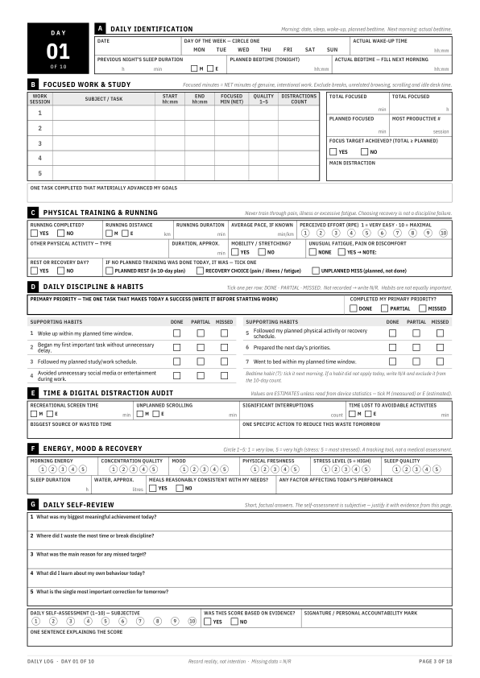

# LifePlay — 10-Day Personal Performance Audit

A print-ready A4 logbook for checking your discipline, focused work, physical training, recovery and time use over 10 days. Write down what actually happened, not what you meant to do.

**Download:** [`10_Day_Personal_Performance_Audit.pdf`](10_Day_Personal_Performance_Audit.pdf) (18 pages, A4 portrait, monochrome)

| Page | Content |
|---|---|
| 1 | **Personal Performance Mission**: name/callsign, dates, objective, targets, behaviours to eliminate and strengthen, standing orders, N/R rule |
| 2 | **Operating rules**: daily routine, marking key, metric definitions, 10-day plan (planned run/rest days) |
| 3–12 | **Daily log, Day 01–10**: one page per day, sections A–G (identification, focused work, training, habits, distraction audit, energy and recovery, self-review) |
| 13 | **10-day trend and summary**: one row per day, trend plot, totals and averages with explicit calculation rules |
| 14 | **Final analysis A**: consistency (habit tally, streaks, first half vs second half, best and worst day) |
| 15 | **Final analysis B**: time and productivity (intention vs reality, best vs worst days comparison) |
| 16 | **Final analysis C**: physical performance (10-day training strip, totals, decision gate for the next block) |
| 17 | **Final analysis D**: personal pattern detection (evidence column for every answer) |
| 18 | **Final analysis E**: next 10-day action plan (ACTION · MEASURE · TARGET · WHEN · HOW I WILL VERIFY IT) and declaration |



## Printing

- Print on **A4** at **100 % / "Actual size"**. Don't use "Fit to page".
- Designed for black-and-white printing. No meaning depends on colour.
- Margins are 12 mm at the sides and at least 7 mm under the footer, which suits normal home and office printers.

## Core rules (printed in the document)

- **N/R = not recorded.** It counts as neither success nor failure. Leave it out of every total, count and average, and write the number of recorded days (`n`) beside each figure.
- A genuine **0** (for example, 0 km on a rest day) is recorded data. Write 0, not N/R.
- **M / E** marks whether a value was measured (device, app or timer) or estimated.
- **Planned rest**, **recovery choice** (pain, illness or fatigue) and **unplanned miss** are tracked separately. Only an unplanned miss counts against discipline.
- The daily self-rating is subjective. It is never treated as proof of performance.

## Customise and rebuild

All labels, habits, prompts and optional pre-printed targets are in the `CONFIG` block at the top of [`build_audit.py`](build_audit.py).

```bash
pip install -r requirements.txt
python build_audit.py          # writes 10_Day_Personal_Performance_Audit.pdf
python qa_check.py             # automated layout and content checks
```

To pre-print your own details, set values in `CONFIG["prefill"]`. Any value left as `""` stays a blank field for handwriting. Setting `start_date` (for example `"2026-10-19"`) prints every daily date and circles the weekday.

`qa_check.py` checks all of the following:

- 18 A4 pages, each numbered
- every page stays inside the margins and above the footer
- no text smaller than 6.2 pt
- all 10 daily sheets are present, each with its own date field and every required field in sections A–G
- every required section and phrase is present across the document

The generator also stops with warnings if a label would overflow its cell after you edit the text.

## Files

- `10_Day_Personal_Performance_Audit.pdf`: the deliverable
- `build_audit.py`: editable source (ReportLab)
- `qa_check.py`: quality-assurance checks (PyMuPDF)
- `fonts/`: IBM Plex Sans Condensed, licensed under the SIL Open Font License 1.1 (`fonts/OFL.txt`)
- `docs/preview/`: page previews
